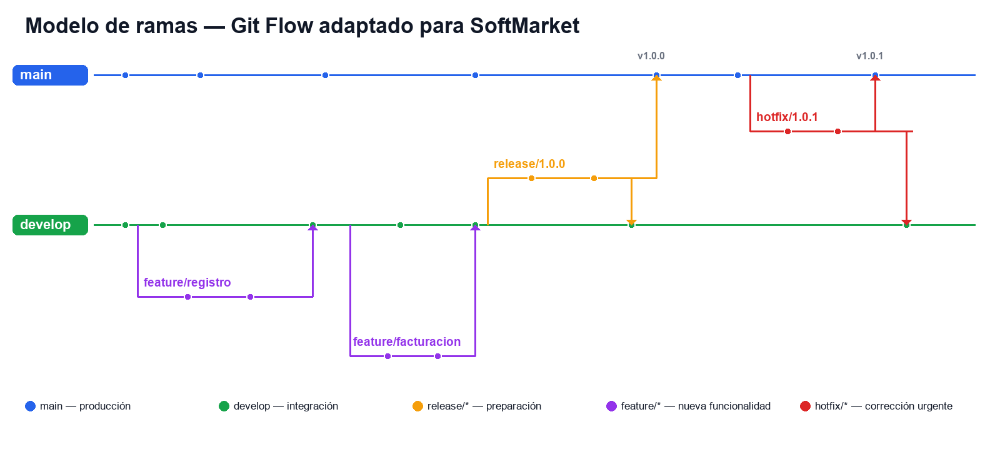

# Modelo de ramas y flujo de versionamiento

## Flujo paso a paso

1. El desarrollador crea feature/nombre a partir de develop.
2. Realiza commits pequeños siguiendo Conventional Commits.
3. Abre un pull request hacia develop y solicita revisión.
4. La integración continua ejecuta lint, pruebas y build.
5. Tras la aprobación, la rama se fusiona en develop con --no-ff.
6. Al acumular cambios suficientes se crea release/x.y.z.
7. La versión estable se fusiona en main y se etiqueta con un tag semántico.
8. Los errores críticos se corrigen en hotfix/x.y.z desde main y se integran
   en main (nuevo tag) y en develop.
